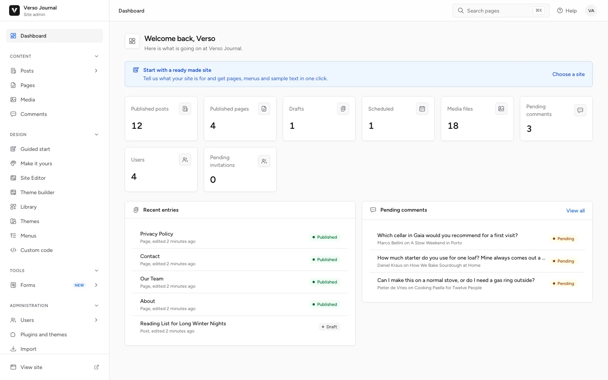
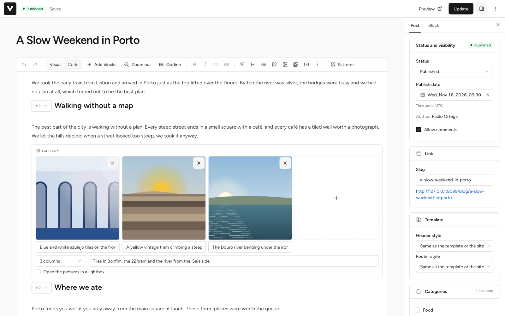
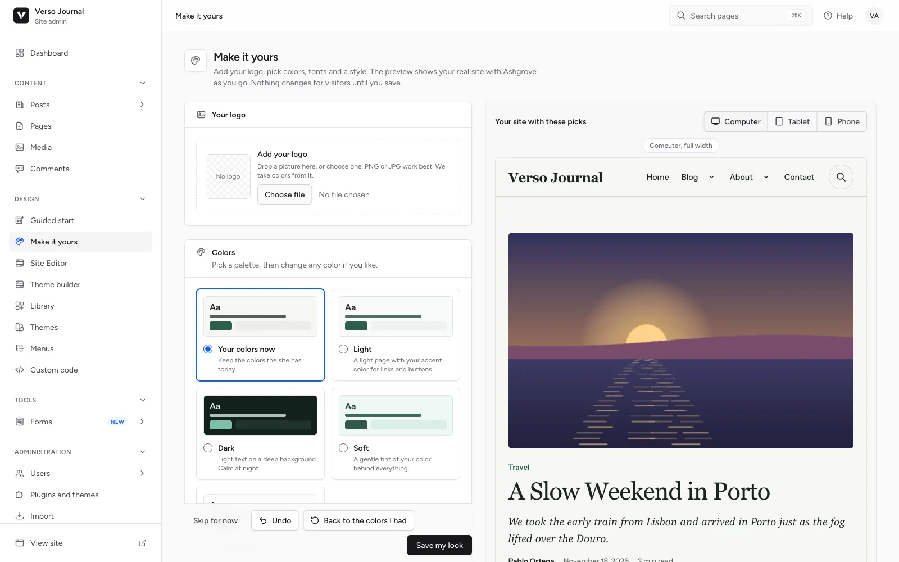
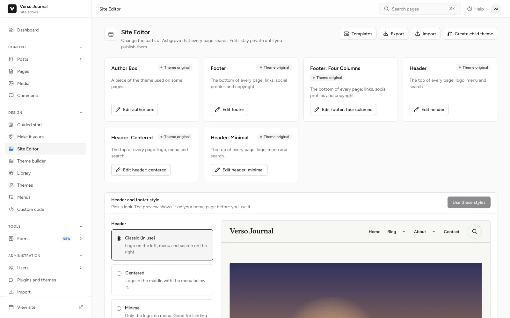

# Verso

[](https://github.com/victoragudo/verso/actions/workflows/ci.yml) [](https://verso-cms.pages.dev)

Verso is a free and open source content management system built on Laravel 13. It is a fast, modern and safe alternative to WordPress, released under the MIT license. There is no paid edition and no locked feature.

**Website:** [verso-cms.pages.dev](https://verso-cms.pages.dev)



| Block editor | Make it yours | Site Editor |
| --- | --- | --- |
| [](docs/screenshots/editor.webp) | [](docs/screenshots/make-it-yours.webp) | [](docs/screenshots/site-editor.webp) |

## Features

- **Block editor.** A Tiptap based editor with paragraphs, headings, lists, quotes, code, images, galleries, embeds, columns, buttons, tables, video and raw HTML (admins only). A slash menu, drag to reorder and keyboard shortcuts. Content is stored as JSON blocks and rendered to sanitized HTML.
- **Posts, pages and custom types.** Content types and taxonomies are defined in code. Pages can be nested. Drafts, scheduled posts, trash and revisions are built in.
- **Media library.** Uploads with type and size checks, alt text and captions, a picker inside the editor, and a usage check before a file is deleted. Images are resized on the fly with Glide (WebP and AVIF) and served with a responsive `srcset`.
- **Themes.** Blade themes in `themes/<slug>`. Two themes ship with Verso: Verso Default and Ashgrove, an editorial blog theme. The default theme is plain CSS, has no JavaScript, supports dark mode and is built for accessibility. A theme customizer edits colors, fonts, sizes, a logo and footer text from the theme's `theme.json`, with a live preview. Child themes, a template hierarchy, page templates, template parts and block patterns are built in (see [docs/THEME-GUIDE.md](docs/THEME-GUIDE.md) and [docs/THEMES.md](docs/THEMES.md)).
- **Custom fields.** Field groups with 22 field types, repeaters, conditional logic and location rules, built in the admin, in JSON files or in code. Values show in the entry editor, in themes (`field('name')`) and in the REST API.
- **Fast by default.** A full page cache for guests that is served before the session starts, with ETag and 304 answers, and is cleared when content, terms, menus, approved comments or settings change. Query budgets are tested, and `php artisan verso:benchmark` measures the public routes (see [docs/PERFORMANCE.md](docs/PERFORMANCE.md)). Static export with `php artisan verso:export`.
- **SEO.** Per entry title, description, canonical URL, noindex and share image. Open Graph, Twitter cards, schema.org JSON-LD, XML sitemaps and an editable robots.txt. Permalink, sitemap and search engine settings in the admin. Live SEO and readability checks in the editor, an SEO overview, a link check, a 404 monitor and an alt text screen.
- **Menus and redirects.** A menu builder with theme locations, and 301/302 redirects that never chain.
- **Users and roles.** Admin, editor, author, contributor, subscriber and shop manager roles. Admins can change what each role can do, add their own roles and give extra capabilities to one user. Plugins can declare capabilities and roles. Invitations by email. The last admin can never be removed.
- **Comments.** Threaded comments with moderation, a honeypot, a time trap, link spam scoring and rate limiting.
- **Plugins.** Typed plugins with a `verso.json` manifest, declared permissions, typed filters, admin slots for React components, custom blocks (with child blocks), entry editor panels, their own migrations and admin pages. Plugins can live in `plugins/` or come as Composer packages. Every filter and slot is in [docs/EXTENDING.md](docs/EXTENDING.md).
- **Extensions manager.** Upload a plugin or theme zip, check it before anything is unpacked, review its permissions and install, update with rollback, or remove it with or without its data. An optional registry adds a Browse tab.
- **Plugin and theme verification.** Every plugin is scanned before install (dangerous calls, obfuscation, undeclared permissions and network hosts, clashes) and booted in a sandbox. The report gives a risk level; high risk plugins need the slug typed again or can be blocked. `php artisan verso:verify-plugin` runs the same checks. Themes are checked too (missing views, risky code, a sandbox render of demo pages) with `php artisan verso:verify-theme`.
- **Core updates.** An Updates page checks the release feed, shows the changelog and updates Verso in one click with a checksum check, backups, migrations, a health check and automatic rollback. `php artisan verso:update` does the same.
- **Read-only REST API** under `/api/v1` for entries, terms and media.
- **WordPress importer.** Imports a WXR export (posts, pages, terms, authors, media, comments, Yoast and Rank Math SEO) and creates redirects from the old URLs. It can run again without making copies.
- **Site Editor and builder.** Edit headers, footers and other template parts with blocks, global styles, menus with theme locations, and full templates with dynamic blocks and conditions. Grid, stack and interactive blocks, style presets, synced blocks, a design library, popups and banners. Every size accepts any CSS unit.
- **Easy mode.** A guided start with starter sites, a "Make it yours" step for logo, colors, fonts and style, a visual page editor with ready sections, a simple admin mode, a launch checklist and a help panel. Built so a person with no technical knowledge can make a small site.
- **Admin in 15 languages.** English, Spanish, Simplified Chinese, Hindi, Arabic (right to left), Brazilian Portuguese, Bengali, Russian, Japanese, French, German, Indonesian, Turkish, Korean and Italian. Each user picks their own language (see [docs/I18N.md](docs/I18N.md)).
- **Installer.** A web installer at `/install` and an `php artisan verso:install` command.

## Bundled plugins

All are off by default. Turn them on in **Admin > Plugins**; their tables are created when they are enabled.

| Plugin | What it does |
| --- | --- |
| Reading Time (`plugins/reading-time`) | Reading time block and API field. The small example plugin. |
| Shop (`plugins/shop`) | Products with variants and stock, cart, checkout, orders, bank transfer and Stripe Checkout, order emails. |
| Newsletter (`plugins/newsletter`) | Double opt-in signup block, lists, CSV import and export, campaigns written with blocks and sent in batches. |
| Memberships (`plugins/memberships`) | Plans with levels, members only entries and blocks, a teaser for visitors. |
| Analytics (`plugins/analytics`) | Privacy first visitor stats: no cookies, no personal data, respects Do Not Track and Global Privacy Control. |
| AI Assistant (`plugins/ai-assistant`) | Outlines, rewrites, excerpts, SEO tags, alt text and translations in the entry editor with Claude. Needs an Anthropic API key. |
| Forms (`plugins/forms`) | Contact forms with a form builder, a submissions inbox, CSV export, email notifications and spam protection without third parties. |
| Builder Example (`plugins/builder-example`) | Shows how to extend the block builder: a notice block, an opacity style, a tips panel and a drop rule. |

## Requirements

- PHP 8.4 or newer (the HTML sanitizer uses the PHP 8.4 HTML5 parser) with the `gd` or `imagick`, `pdo`, `mbstring`, `xml` and `fileinfo` extensions.
- Composer 2.
- Node.js 22 or newer and npm, to build the admin.
- SQLite (default), MySQL 8.4 or PostgreSQL 17. See [Databases](#databases).

Verso runs on ordinary PHP-FPM hosting. Octane is optional.

## Install

### With Composer (recommended)

```bash
composer create-project victoragudo/verso my-site
cd my-site
php artisan serve
```

Composer downloads Verso and its dependencies, creates `.env`, links the storage folder and builds the admin assets (this step needs Node.js 22 or newer). Then open http://localhost:8000: the install wizard asks for the database, your admin account and what your site is for.

### Download a release (shared hosting)

Download `verso-<version>.zip` from the [latest release](https://github.com/victoragudo/verso/releases/latest). It already includes `vendor` and the built assets, so no Composer or Node.js is needed. Upload it, point the web root at the `public` folder and open the site to start the wizard.

### From source (contributors)

```bash
git clone https://github.com/victoragudo/verso.git
cd verso
composer run setup
php artisan storage:link
```

Then open `/install` in your browser to create the first admin, or run:

```bash
php artisan verso:install
```

For a demo site with sample content, run `php artisan migrate:fresh --seed` instead. The demo admin is `admin@verso.test` with the password `password`.

To move a WordPress site, export it from **Tools > Export** in WordPress and run:

```bash
php artisan verso:import-wordpress path/to/export.xml
```

or upload the file at **Admin > Import**.

## Configuration

Every operational value lives in `config/verso.php` and can be changed with an environment variable. `.env.example` lists all of them with their defaults. Site level options (name, tagline, locale, posts per page, front page, comments, robots.txt) are edited in **Admin > Settings**.

## Databases

SQLite is the default and needs no server. To use MySQL or PostgreSQL, set the connection in `.env` and run the migrations:

```dotenv
DB_CONNECTION=mysql   # or pgsql
DB_HOST=127.0.0.1
DB_PORT=3306          # 5432 for pgsql
DB_DATABASE=verso
DB_USERNAME=verso
DB_PASSWORD=secret
```

CI runs the whole test suite on SQLite, MySQL 8.4 and PostgreSQL 17 with PHP 8.4 and 8.5. The `DB_*` variables also choose the database for `php artisan test`. To run the suite on MySQL and PostgreSQL locally, with Docker installed:

```bash
scripts/test-databases.sh            # both
scripts/test-databases.sh pgsql      # only PostgreSQL
```

The script starts temporary containers on free ports (`VERSO_TEST_MYSQL_PORT`, `VERSO_TEST_PGSQL_PORT`) and removes them at the end. The test database user must be able to create databases, because parallel tests use one database per process.

## Development

```bash
composer run dev
```

This starts the Laravel development server, a queue worker, the log viewer (Pail) and Vite. Run `npm test` (or `npx vitest` to watch) for the admin JavaScript tests.

The code is organised in modules under `app/Verso/<Module>`. Read [docs/ARCHITECTURE.md](docs/ARCHITECTURE.md) before you change anything: it describes the contracts between modules, the block format and the admin design rules.

Useful generators:

```bash
php artisan verso:make-plugin "Event Calendar"
php artisan verso:make-block "Venue" --plugin=event-calendar
php artisan verso:make-theme "Harbour"
```

## Testing

```bash
php artisan test
vendor/bin/pint --test
vendor/bin/phpstan analyse --memory-limit=1G
npm run types:check
npm test
npm run build
```

All six must pass before a change is merged. Code that queries the database must also pass on MySQL and PostgreSQL (see [Databases](#databases)).

`npm test` runs the admin JavaScript tests with Vitest and jsdom. They live in `resources/js/tests`, next to the code they cover by folder. Use `npm run test:coverage` for a coverage report in `coverage/`.

`npm run test:e2e` runs the browser journeys with Playwright (`tests/e2e`): a fresh install through the web wizard to a finished site built with Easy mode only, at 1440x900 and at 390x844 (touch). Run `npm run build` first, and `npx playwright install chromium` once. Each screen size gets its own server (`scripts/e2e/serve.mjs`, PHP built-in server on a free port) with a throwaway SQLite database, storage folder, `.env` and install lock in the system temp folder, so your `.env` and `database/database.sqlite` are never touched. `E2E_KEEP=1` keeps the temp folder for debugging; traces and screenshots of failures go to `test-results/`.

`npm run test:e2e:install` checks the documented install: it runs `composer create-project` from this checkout (a path repository) in a temp folder, starts `php artisan serve`, goes through the whole web wizard with SQLite (the server restarts when the wizard writes `.env`) and logs in to the admin with the new account. It takes a few minutes because the new project installs its own Composer and npm packages.

## Roadmap

- More themes.
- Multisite and content in more than one language.

See [docs/PROGRESS.md](docs/PROGRESS.md) for the current status.

## Documentation

- [docs/README.md](docs/README.md): the index of all the docs.
- [docs/ARCHITECTURE.md](docs/ARCHITECTURE.md): modules, contracts, the block format and the admin design rules.
- [docs/THEME-GUIDE.md](docs/THEME-GUIDE.md): how to build a theme, step by step.
- [docs/THEMES.md](docs/THEMES.md): the theme reference.
- [docs/EXTENDING.md](docs/EXTENDING.md): plugins, filters, admin slots, capabilities and builder registries.
- [docs/CONFIGURATION.md](docs/CONFIGURATION.md): every setting and environment variable.
- [docs/I18N.md](docs/I18N.md): translations of the admin, plugins and themes.
- [docs/PERFORMANCE.md](docs/PERFORMANCE.md): caches and query budgets.

## Contributing

Contributions are welcome. Please read [CONTRIBUTING.md](CONTRIBUTING.md).

## License

Verso is open source software released under the [MIT license](LICENSE).
